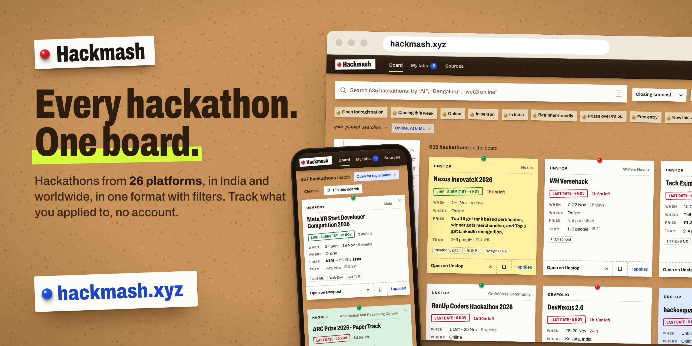
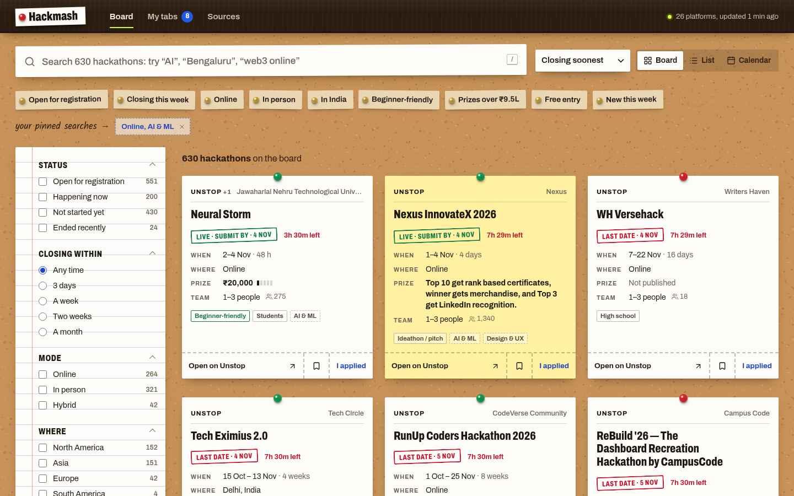
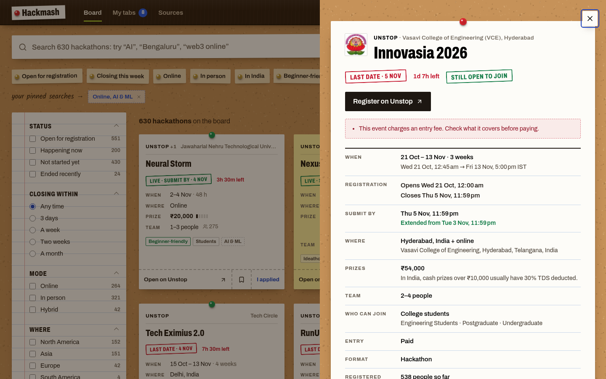
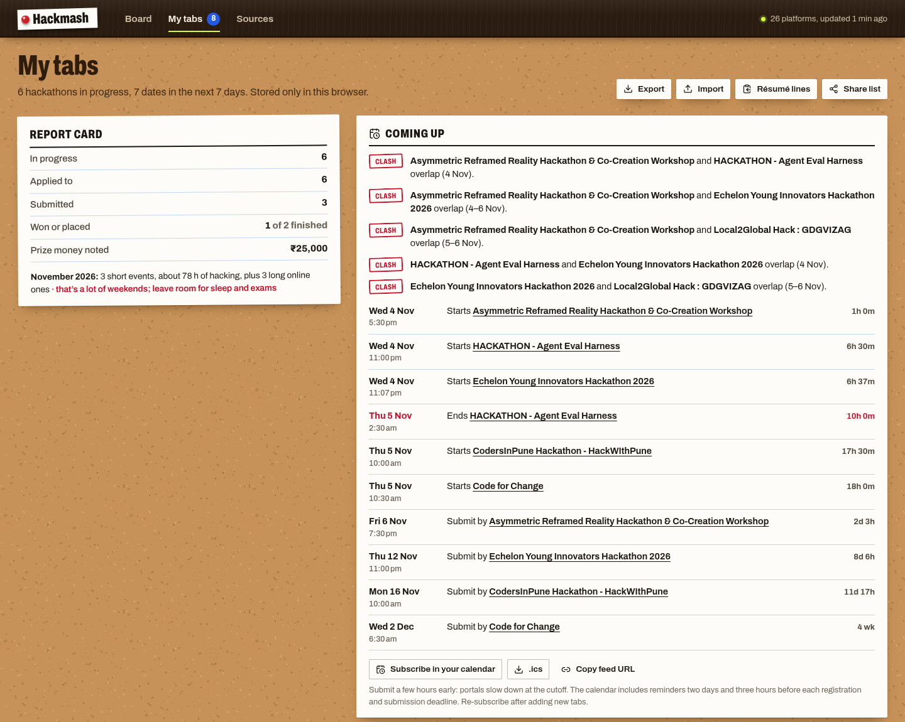

<p align="center"><a href="https://hackmash.xyz"></a></p>

<h1 align="center">Hackmash</h1>

<p align="center"><strong>Every hackathon from every platform, on one board.</strong></p>

<p align="center">
Devpost, Unstop, Devfolio, MLH, HackerEarth, Hack2skill, DoraHacks, ETHGlobal, Kaggle and 16 more,
in one format, with filters that help you choose. Apply on the original platform; track what you applied to right here, with no account.
</p>

<p align="center"><a href="https://hackmash.xyz"><strong>hackmash.xyz →</strong></a></p>



## Why

Hackathons are scattered over dozens of platforms. Indian college events live on Unstop and Devfolio, corporate ones on HackerEarth and Hack2skill, global ones on Devpost and MLH, Web3 on DoraHacks and ETHGlobal, AI on lablab.ai, ML on Kaggle. No platform lists its competitors' events, so students juggle tabs, WhatsApp forwards and spreadsheets, and still miss registration deadlines. Hackmash reads all of them every three hours, puts every event into one format and pins it to one board.

## What it does

**One board, every platform**
- 25 sources (listed below), refreshed every three hours.
- The board shows what you can still sign up for. Searching also finds events under way whose registration has closed, marked as such; anything else (ended, or closed and not started) opens from its link.
- The same event listed on several platforms (for example MLH + Devpost) is merged into one notice with "Also on" links.
- Every notice links straight to the page where you register. Hackmash never sits between you and the apply button.

**One format**
- Dates and times in your timezone, with a countdown to the next date that matters (registration close, submission, start or end).
- Prize pools in your chosen currency at the day's exchange rate (INR, USD, EUR, GBP, CAD, AUD, SGD), plus a five-step prize-size ramp.
- The same fields for every platform: mode, place, team size, who can join, entry fee, registrations so far. Unknown values are shown as unknown, never guessed.

**Filters that matter**
- Status: happening now or not started yet.
- Closing within 3, 7, 14 or 30 days. Start date range.
- Online, in person or hybrid. Region and country.
- Platform. 24 themes (AI & ML, Web3, FinTech, HealthTech, Climate, Social Good…).
- Prize pool size. Format: hackathon, ideathon/pitch, coding contest, data science.
- Who it's for: college students, high school, women & non-binary, professionals, startups.
- Your team size (hides events whose limits rule your team out).
- Beginner-friendly, free entry, travel reimbursed, posted this week, offers jobs or internships, clear of your busy dates.
- Facet counts update live as you filter. Every filter lives in the URL, so a search is shareable.
- Quick filter slips, pinned searches, and "hide this notice" to clear what you don't care about.

**Board, list and calendar views**
- Board for browsing, a dense register for scanning, and a month planner showing what starts and which registrations close on each day.
- Press <kbd>/</kbd> to search.

**My tabs (the tracker)**
- Press **I applied** on a notice and its tab tears off into My tabs. **Save** keeps something for later.
- Statuses: Saved → Applied → Submitted → Shortlisted → Won / Didn't place / Dropped.
- A diary of upcoming deadlines (registration for saved events, submissions for applied ones), with urgent ones in red.
- Clash warnings when two intense events overlap, and a monthly count of hacking hours so you don't book every weekend before exams.
- Busy dates (exams, trips, fests): events that clash are flagged on the board, in the notice and in your diary, and the board can hide them.
- Per-hackathon checklist (rules read, team, repo, demo video, deck, submitted), notes, team, project link, and what you won.
- A report card (applied, submitted, won, prize money) and one-click résumé lines: your hackathons, results and project links as Markdown for your CV or LinkedIn.
- Calendar: add any notice to Google Calendar, download an `.ics` with reminders 2 days and 3 hours before each deadline, or subscribe to a live feed of all your tabs.
- Private by design: no accounts. Everything lives in your browser's localStorage. Export/import a JSON backup to move devices, or share a list link with teammates.

**Honest data**
- Paid-entry and invite-only events are flagged; invite-only and test events are left off the board.
- Deadline extensions are detected between refreshes and shown as "Deadline extended", with the old date.
- Hiring challenges (PPOs, internships, placement interviews) are labelled so you know what you're signing up for.
- For Indian winners, a note that cash prizes over ₹10,000 usually have 30% TDS deducted.
- When a platform stops listing an event it is marked and leaves the board, but it stays in your tabs.
- Every notice shows where it came from and when it was last checked. The [Sources](#platforms) page shows each platform's health.

**Link previews**
- Share a notice and WhatsApp, X, LinkedIn, Slack or Discord shows a poster for it: the title, the deadline stamp, the prize, where and when, in the board's own paper-and-stamp look, with a one-line summary under it.
- Every hackathon gets its own poster, drawn by the home server and redrawn only when what it shows changes. Dates are absolute ("Last date · 13 Nov"), because apps keep a preview for days.

**Public API**
- `GET /api/hackathons` with the same filters, and every listing by id. See [API](#api).

<p align="center">


</p>

## Platforms

| Region | Platform | Known for |
|---|---|---|
| India | [Unstop](https://unstop.com/hackathons) | India's largest student hackathon and competition platform (formerly Dare2Compete) |
| India | [Devfolio](https://devfolio.co/hackathons) | Indian college hackathons and Ethereum events (ETHIndia, HackThisFall…) |
| India | [HackerEarth](https://www.hackerearth.com/challenges/) | Corporate hackathons and hiring challenges |
| India | [Hack2skill](https://hack2skill.com/hackathons-listing) | Google, government and corporate hackathons in India |
| India | [TechGig](https://techgig.com/hackathons) | Corporate AI hackathons by The Economic Times |
| India | [Reskilll](https://reskilll.com/allhacks) | Corporate and brand hackathons |
| India | [Devnovate](https://devnovate.co/events) | Hack With India city hackathons and college events |
| India | [Commudle](https://www.commudle.com/hackathons) | Community-run developer hackathons |
| Global | [Devpost](https://devpost.com/hackathons) | The biggest global hackathon platform |
| Global | [Major League Hacking](https://www.mlh.com/events) | Official student hackathon league (MLH member events) |
| Global | [Hack Club](https://hackathons.hackclub.com/) | High-school hackathons worldwide |
| Global | [Luma](https://luma.com/discover) | City tech and AI hackathons (SF, NYC, London, Bengaluru…) |
| Global | [Google Developer Groups](https://gdg.community.dev/events/) | Hackathons run by GDG chapters |
| Global | [Hackathon.com](https://www.hackathon.com/) | Corporate innovation challenges (BeMyApp) |
| Global | [AngelHack](https://angelhack.com/events/) | Corporate and Web3 hackathons |
| Global | [Hackster.io](https://www.hackster.io/contests) | Hardware and embedded build contests |
| Global | [DoraHacks](https://dorahacks.io/hackathon) | The largest Web3 hackathon platform |
| Global | [ETHGlobal](https://ethglobal.com/events) | Ethereum hackathons, in person and online |
| Global | [TAIKAI](https://taikai.network/hackathons) | Corporate, EU-programme and Web3 hackathons |
| Global | [HackQuest](https://www.hackquest.io/hackathons) | Web3 ecosystem hackathons and buildathons |
| Global | [Encode Club](https://www.encodeclub.com/programmes) | Web3 and AI hackathons with ecosystem partners |
| Global | [AKINDO](https://app.akindo.io/wave-hacks) | Web3 WaveHack grant sprints |
| Global | [Kaggle](https://www.kaggle.com/competitions) | Machine-learning competitions |
| Global | [Zindi](https://zindi.world/competitions) | Data-science competitions for Africa and the Global South |
| Global | [DrivenData](https://www.drivendata.org/competitions/) | Social-impact ML competitions |

How each platform is read, and the ones that could not be added (login walls, JavaScript-only pages, defunct sites), is documented in [docs/platforms.md](docs/platforms.md).

## How it works

```
 home server, every 3 hours                       Cloudflare
┌──────────────────────────────┐   HTTPS   ┌─────────────────────────────────────────┐
│ hackmash sync (Python)       │  bearer   │ Worker (TypeScript)                     │
│  25 platform adapters        │   key     │  /api/ingest/*  writes ──▶ D1 (SQLite)  │
│  normalise, dedupe, catalog  │ ────────▶ │  /api/*         reads  ◀── D1           │
│  send only the changed rows  │           │  static assets: the React app           │
└──────────────────────────────┘           └─────────────────────────────────────────┘
                                                        ▲ /api/catalog (cached, ETag)
                                                     browsers
```

- **Backend (Python 3.12)**, in `backend/hackmash/`, runs on a home server:
  - `sources/`: one adapter per platform. Each uses that platform's public JSON API, embedded page data (`__NEXT_DATA__`, JSON-LD) or HTML.
  - `normalize.py`: canonical themes, audiences, countries and regions, plus currency conversion.
  - `dedupe.py`: fuzzy title + date matching across platforms.
  - `pipeline.py`: concurrent fetching with per-source timeouts. A failing source keeps its last good listings.
  - `catalog.py`: builds the catalog. `sync.py`: turns it into database rows and sends the ones that changed.
  - `api.py`: the same API as FastAPI, for running everything locally without Cloudflare.
- **State** is one JSON document (`state.json.gz`) holding listings with first/last-seen times, deadline changes and per-source run logs. It stays on the home server.
- **Database: Cloudflare D1.** One row per hackathon: a compact `card` (what the board needs), the full `detail`, a content hash and `listed_until`. Schema: `worker/migrations/`.
- **Worker (TypeScript)**, in `worker/src/`. It joins the cards of every current hackathon into the feed the web app downloads (about 70 KB compressed), builds it once per sync and keeps it in memory, in Cloudflare's cache and in browsers (ETag, so a returning visitor gets a 304). Detail views, closed and ended listings, calendars and search are served from D1 on demand. Writes come only through `/api/ingest/*` with a secret key. For a shared link (`/?h=<id>`) it rewrites the page's preview tags, since link-preview crawlers don't run JavaScript.
- **Frontend (React 19, TypeScript, Vite)**, in `frontend/`. It filters the feed in the browser, so filtering is instant, re-checks it every 30 minutes while open, and fetches a notice's long text when you open it. The tracker is `localStorage` only.

## Run it locally

Needs [uv](https://docs.astral.sh/uv/) and Node 20+.

```bash
# 1. backend: fetch every platform, then serve the API + built web app on :8000
cd backend
uv sync
uv run hackmash refresh          # ~1–2 minutes; prints a line per platform
uv run hackmash serve            # http://127.0.0.1:8000  (re-fetches every 4 h by itself)

# 2. frontend, in another terminal (hot reload on :5173, proxies /api to :8000)
cd frontend
npm install
npm run dev

# production build: the backend serves frontend/dist automatically
npm run build
```

Settings (environment variables): `HACKMASH_REFRESH_HOURS` (default 4), `HACKMASH_AUTO_REFRESH=0` to disable the background refresher, `HACKMASH_DATA_DIR`, `HACKMASH_STATIC_DIR`, `HACKMASH_ADMIN_TOKEN` (enables `POST /api/admin/refresh`), and `KAGGLE_USERNAME` / `KAGGLE_KEY` (enable the Kaggle adapter).

### CLI

```bash
uv run hackmash sources            # list adapters
uv run hackmash fetch unstop       # run one adapter: item count, field coverage, problems, samples
uv run hackmash fetch unstop --json
uv run hackmash refresh devpost mlh   # fetch some (or all) sources and write the catalog
uv run hackmash rebuild            # rewrite the catalog from saved state, no fetching
uv run hackmash push --dry-run     # what would change in the site's database
uv run hackmash sync               # refresh + push + posters: what the home server runs
uv run --extra og hackmash og --out /tmp/posters --only devpost-31024   # draw link-preview posters to look at
uv run pytest                      # tests
```

### API

Free to use at `https://hackmash.xyz`, read-only, CORS open.

| Endpoint | What it returns |
|---|---|
| `GET /api/catalog` | Every current hackathon (the feed the web app uses), with taxonomy, exchange rates and platform health. ETag-cached |
| `GET /api/hackathons?q=&source=&mode=&theme=&country=&status=&min_prize_usd=&beginner=&free=&sort=&page=` | Current listings, filtered, sorted and paginated. `status` is `open`, `live` or `upcoming` |
| `GET /api/hackathons?ids=a,b,c` | Listings by id, ended ones included (up to 300) |
| `GET /api/hackathons/{id}` | One listing, ended or not, with `status`, `registration_open` and `next_deadline` |
| `GET /api/hackathons/{id}/calendar.ics` | The event plus registration/submission deadlines, with reminders |
| `GET /api/calendar.ics?ids=a,b,c` | A subscribable calendar for a list of hackathons |
| `GET /api/sources` | Platforms and their fetch health |
| `GET /api/health` | Whether data is in, and how fresh it is |
| `GET /og/{id}.jpg` | A hackathon's 1200×630 link-preview poster |

Ended events stay reachable by id for 90 days. Locally, `hackmash serve` offers the same routes plus interactive docs at `/api/docs`.

## Adding a platform

Create `backend/hackmash/sources/<key>.py` with a `Source` subclass. It is discovered automatically.

```python
class MyPlatform(Source):
    key = "myplatform"
    name = "My Platform"
    homepage = "https://myplatform.example/hackathons"
    region = "global"            # or "india"
    focus = "One-line summary"

    async def fetch(self, client) -> list[RawHackathon]:
        data = await get_json(client, "https://myplatform.example/api/hackathons")
        return [RawHackathon(source=self.key, source_id=str(r["id"]), title=r["name"], url=r["url"],
                             starts_at=to_utc(r["start"]), ...) for r in data]
```

Run `uv run hackmash fetch myplatform` until it reports "no problems found", and spot-check a few items against the live site. `sources/devpost.py` is a complete reference adapter. `sources/base.py` has helpers for retries, bounded concurrency, dates, money and text.

## Deploying

### The site: Cloudflare Workers and D1

Needs a Cloudflare API token with *Workers Scripts: Edit* and *D1: Edit* (the *Edit Cloudflare Workers* template plus D1), in `CLOUDFLARE_API_TOKEN`.

```bash
cd worker && npm install
npx wrangler d1 create hackmash --location apac   # once; put the database_id into wrangler.jsonc
openssl rand -hex 32 | npx wrangler secret put INGEST_KEY   # once; keep the value for the home server
npm run deploy      # builds the web app, applies database migrations, deploys
```

`npm run dev` runs the Worker locally with a local D1 (`npm run db:migrate:local` first, and an `INGEST_KEY` in `worker/.dev.vars`), so `HACKMASH_API=http://127.0.0.1:8787 uv run hackmash push` fills it.

### Keeping it fresh: the home server

Scraping needs real CPython and a few hundred outbound requests, so it runs on a machine you own. Every three hours a systemd timer runs `hackmash sync`: fetch every platform, rebuild the catalog, and send only the rows that changed. It refuses to publish a catalog that looks broken (fewer than 100 listings or 3 healthy platforms) or that would delete more than half the database in one go. The next run repairs a run that failed halfway, because each run compares against what the database actually holds.

It then draws link-preview posters for the hackathons whose poster would look different: headless Chromium renders `backend/hackmash/og/poster.html` (about 5 posters a second), and the site serves them from D1. The browser never touches the network: logos are fetched by Python (https, public addresses only, size-capped, cached) and handed in as data. This needs the `og` extra, which `install.sh` sets up, browser included.

```bash
git clone https://github.com/natyavidhan/hackmash ~/services/hackmash
~/services/hackmash/deploy/home-server/install.sh         # first time: creates ~/.config/hackmash/sync.env
#   put the Worker's INGEST_KEY into ~/.config/hackmash/sync.env (HACKMASH_INGEST_KEY=...)
~/services/hackmash/deploy/home-server/install.sh --now   # installs the timer and runs one sync
```

It runs at 00:17, 03:17, 06:17 … UTC, each time up to 10 minutes later at random, and takes about two minutes.

**Restarts.** The job is a systemd *user* timer, enabled in `~/.config/systemd/user`, so it comes back by itself after a reboot:

- With lingering on, your user's systemd starts at boot, so nobody has to log in. `install.sh` checks it; turn it on once with `sudo loginctl enable-linger $USER`.
- `Persistent=true`: a run missed while the machine was off happens right after boot. `hackmash sync` first waits up to 3 minutes for the network, because a user timer can't wait for the system's `network-online.target`.
- The code (`~/services/hackmash`), the key (`~/.config/hackmash/sync.env`) and the state (`HACKMASH_DATA_DIR`, `~/.local/share/hackmash` in the example config) are ordinary files, so a restart loses nothing.

| To | Run |
|---|---|
| See when it last ran and runs next | `systemctl --user list-timers hackmash-sync.timer` |
| Read its log (add `-f` to follow a run) | `journalctl --user -u hackmash-sync` |
| Run it now (returns when it's done, about two minutes) | `systemctl --user start hackmash-sync` |
| Update the code (applies from the next run) | `git -C ~/services/hackmash pull`, then `deploy/home-server/install.sh` if `deploy/home-server/` changed |
| Stop it | `systemctl --user disable --now hackmash-sync.timer` |

## Project layout

```
backend/              Python package `hackmash`: adapters, pipeline, sync, local API, CLI, tests
frontend/             React + TypeScript + Vite web app
worker/               Cloudflare Worker (TypeScript), D1 migrations, wrangler config
deploy/home-server/   systemd timer and installer for the sync job
docs/                 research on student pain points and the platform landscape
.github/              CI: tests and type checks
```

## Research behind the features

- [docs/research/student-pain-points.md](docs/research/student-pain-points.md): what students on Reddit, Hacker News and other forums say goes wrong with hackathons (scattered listings, missed deadlines, paid or fake events, eligibility confusion, clashing with exams, team logistics), and which feature here addresses each.
- [docs/platforms.md](docs/platforms.md): the hackathon platforms universities, companies and communities use, in India and globally, and how each is read.

## Responsible fetching

Hackmash reads only public pages and public APIs, a few times a day, with bounded concurrency, retries with backoff and an identifying user agent. It links every listing back to its source and stores no personal data. If you run a platform listed here and want changes, open an issue.

## Credits

Thanks [Sushant](https://github.com/sushant-mishra-dtu/) for the idea.
